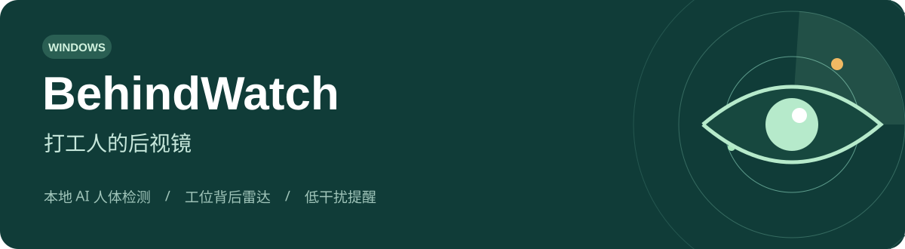
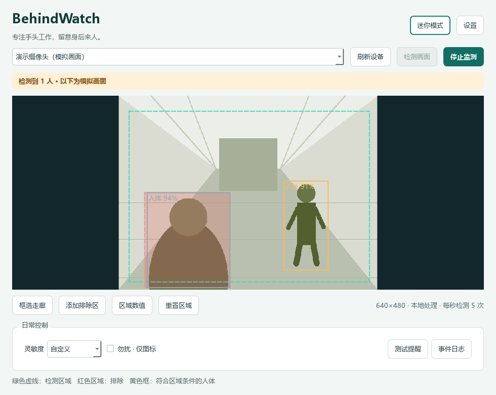

<p align="center">
  
</p>

<p align="center">
  <strong>上班摸鱼神器 · 工位背后雷达 · 打工人的电子后视镜</strong>
</p>

<p align="center">
  <a href="https://github.com/zhangdongsheng636-cmd/BehindWatch/releases/latest">⬇️ 下载 Windows 版</a>
  · <a href="#三步开机进入雷达模式">🚀 快速上手</a>
  · <a href="README_使用说明.md">📖 完整说明</a>
  · <a href="https://github.com/zhangdongsheng636-cmd/BehindWatch/issues">🐛 反馈问题</a>
</p>

---

**工位背对走廊，耳朵快练成雷达了？**

写代码、赶方案、琢磨午饭吃什么……总有那么一瞬间，身后已经站了个人，你还浑然不觉。

**BehindWatch 给你的工位装上一双「电子后视镜」。** 把摄像头对准身后走廊，框选想留意的区域，本地 AI 检测到有人进入并停留时，用一个小弹窗、一声轻响或边框闪烁提醒你。

你负责手头的事，它留意身后的动静。也可以叫它：**打工人监控神器（监测走廊版）**。

> “摸鱼神器”是昵称；软件做的是摄像头可见区域的人体检测。它不识别来人的身份，也不能保证零漏报。把区域和灵敏度调适合自己的工位，比给它起一个霸气名字更管用。

## 长这样



*展示图使用模拟画面，没有真实人物或实际工位照片。绿色虚线是检测区，红色是排除区，黄色框是符合区域条件的人体。*

## 给打工人的小功能

| 功能 | 你会怎么用 |
|---|---|
| 🎥 摄像头选择 | 内置摄像头、普通 USB 摄像头；支持常规 / 兼容模式 |
| 🔄 旋转与镜像 | 摄像头倒着装，也能把画面调正 |
| 🎯 只看这条走廊 | 鼠标框选检测区，排除自己和固定座位 |
| 🧠 本地人体检测 | YOLOX-Nano + ONNX Runtime，在 CPU 上运行 |
| ⏳ 别一闪而过就喊我 | 调节目标大小、置信度、持续确认时间 |
| 🔕 同一个人别一直提醒 | 短期目标跟踪、重复间隔、多人提醒合并 |
| 💬 提醒轻一点 | 角落弹窗、任务栏闪烁、系统通知、音效、屏幕边框 |
| 🌙 勿扰模式 | 继续监测和记日志，只更新图标 |
| 🪟 缩到角落 | 托盘后台、迷你窗口、折叠状态条、四角停靠 |
| 💾 数据放哪，你说了算 | 本地目录可改到 D 盘；设置、日志和截图一起迁移 |

## 三步开机，进入雷达模式

### 1. 下载并完整解压

打开 **[Releases 下载页](https://github.com/zhangdongsheng636-cmd/BehindWatch/releases/latest)**，下载：

**`BehindWatch-1.1.0-Windows-x64.zip`**

完整解压后运行 `BehindWatch.exe`。**无需安装 Python**。请保留同目录的 `_internal` 文件夹，模型和运行库都在里面。

### 2. 先给雷达划个范围

选择摄像头 → **预览画面** → 必要时旋转 / 翻转 → **框选走廊**。

画面里有自己或固定同事时，用 **添加排除区** 避开。红色排除区不宜过大，否则后来进入该区域的人也会被忽略。

### 3. 开始监测，挑一种提醒

点击 **开始监测**。按钮变成 **停止监测**、状态栏显示 **监测中**，就说明已经启动。

默认是角落弹窗和托盘图标。点 **设置 → 提醒** 选择声音、边框等选项，用 **测试提醒** 看看效果。关闭主窗口后继续在托盘运行，退出请使用托盘右键菜单。

## 数据留在自己的电脑

- 摄像头画面在内存中进行本地分析，运行时没有云推理、上传、自动更新或模型下载功能。
- **默认不录像、不保存截图**，只保留本地事件日志。
- 截图是可选功能，开启后只保存触发时的检测区域，支持保留天数和容量上限。
- 模型随下载包提供；开发时安装依赖、补齐模型需要联网，日常使用不需要。
- 在 **设置 → 本地记录 → 更改目录** 中选择空文件夹，例如 `D:\BehindWatch`。迁移保留原文件备份。
- 用户配置目录仍保留小型位置记录和运行锁，新数据写入你选择的目录。

## 这些地方要先说清楚

- **摄像头看得到，才能监测得到。** 先调安装角度，再调灵敏度。
- 背影、遮挡、暗光、远处小目标会影响效果，建议请人从走廊走一遍做现场校准。
- “同一人”指短期跟踪的同一个目标；多人交叉或长时间遮挡可能产生新的轨迹。
- 延长确认时间能减少打扰，也更容易忽略快速路过的人。
- 系统通知可能被 Windows 通知设置拦截；摄像头也可能被会议软件占用。
- 请将镜头和检测区域对准自己需要留意的范围，并尊重周围人的隐私。

## 运行开销与兼容性

面向 Windows 10/11 x64，已在一台 Windows 11 电脑及其内置摄像头上验证。Windows 10、其他 USB 摄像头、多屏混合 DPI、休眠恢复和长期连续运行仍需更多测试。

在一台 **32 逻辑核**电脑上，以 640×480、每秒 5 次检测、预览隐藏、勿扰开启进行约 20 秒短测：

| 项目 | 观测结果 |
|---|---|
| 完整后台流程平均 CPU | 约 0.72%，按整机逻辑 CPU 数量归一化 |
| 峰值工作集 | 约 134 MiB |
| 摄像头样本单次推理中位数 | 约 16 ms |

这只是一次短测，测试 UI 使用 offscreen 平台，**不是对所有电脑的性能承诺**。运行包约 115 MiB，解压约 294 MiB，包含 Python、Qt、OpenCV、模型及推理库。

## 想自己改？从源码跑

建议使用 **Python 3.11 x64**。

```powershell
git clone https://github.com/zhangdongsheng636-cmd/BehindWatch.git
cd BehindWatch
python -m venv .venv
.\.venv\Scripts\python.exe -m pip install -r requirements.txt
.\.venv\Scripts\python.exe main.py
```

模型和素材已包含在仓库中。模型来源及 SHA-256 见 [`models/manifest.json`](models/manifest.json)。

运行测试：

```powershell
.\.venv\Scripts\python.exe -m unittest discover -s tests -v
```

构建 Windows 目录版：

```powershell
.\.venv\Scripts\python.exe -m pip install -r requirements-build.txt
.\.venv\Scripts\python.exe -m PyInstaller --noconfirm --clean BehindWatch.spec
```

输出在 `dist/BehindWatch/`。摄像头相关诊断脚本会明确打开摄像头，详见 [使用说明](README_使用说明.md)。

## 项目结构

```text
app/          界面、摄像头、本地检测、事件规则、提醒、存储与目录迁移
models/       YOLOX-Nano 模型与校验信息
assets/       图标和提示音
tests/        事件规则、区域、线程与迁移测试
tools/        构建与诊断工具
docs/         模拟展示图和发布说明
licenses/     第三方许可文本
```

## 反馈与后续想法

遇到问题欢迎 [提交 Issue](https://github.com/zhangdongsheng636-cmd/BehindWatch/issues)。可以提供 Windows 版本、摄像头型号和复现步骤；请先去掉截图中的人物、工作资料和个人路径。

后续想继续改善：真实工位的误报过滤、更多摄像头兼容性、长时间稳定性和更小的发行包。觉得有用，欢迎点个 ⭐，让更多背对走廊的打工人找到自己的后视镜。

## 致谢与许可

检测模型来自 [YOLOX](https://github.com/Megvii-BaseDetection/YOLOX)，感谢 PySide6 / Qt、OpenCV、ONNX Runtime 和 cv2-enumerate-cameras。

项目源码公开供查看，暂未指定项目整体的开源许可证；第三方模型、库及其许可独立保留，详见 [第三方说明](THIRD_PARTY_NOTICES.md)。
